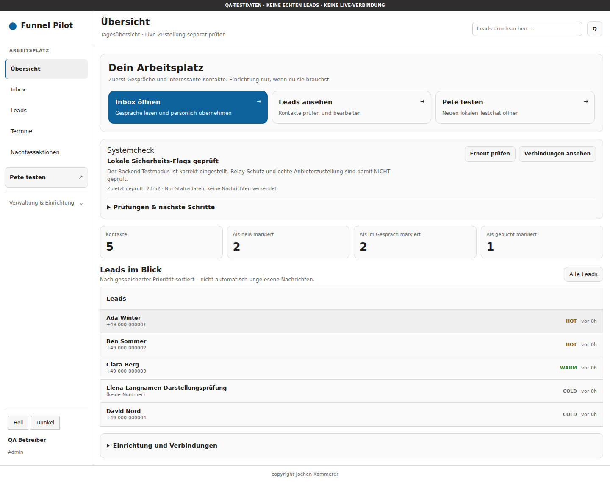
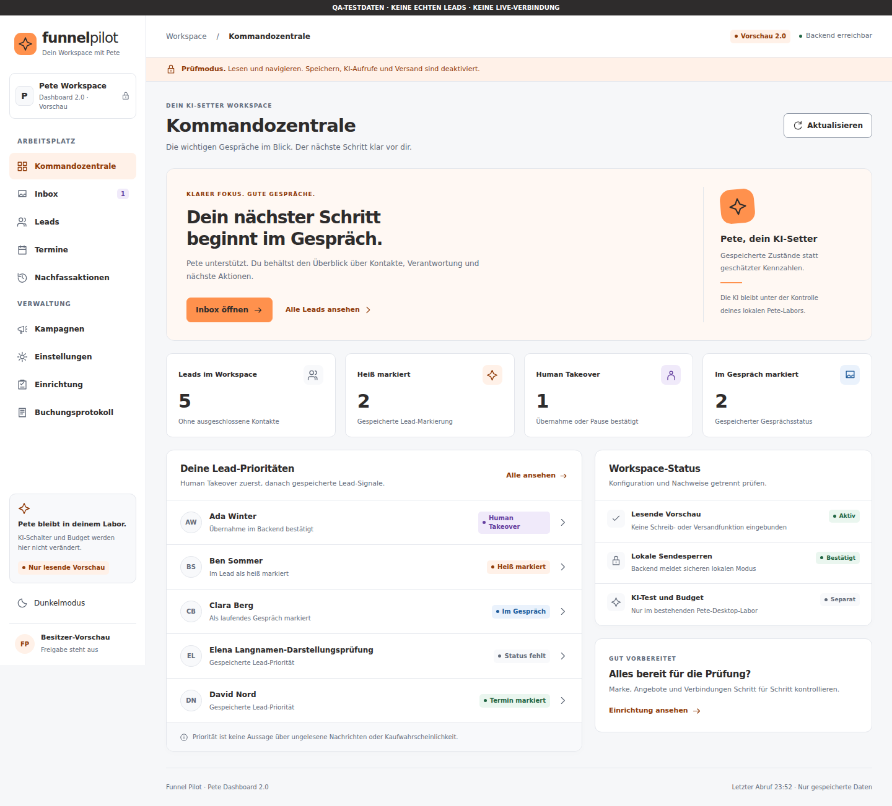
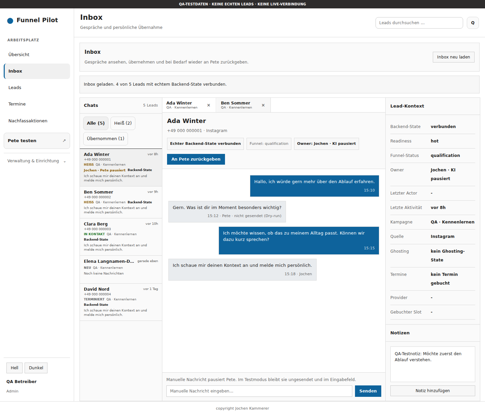
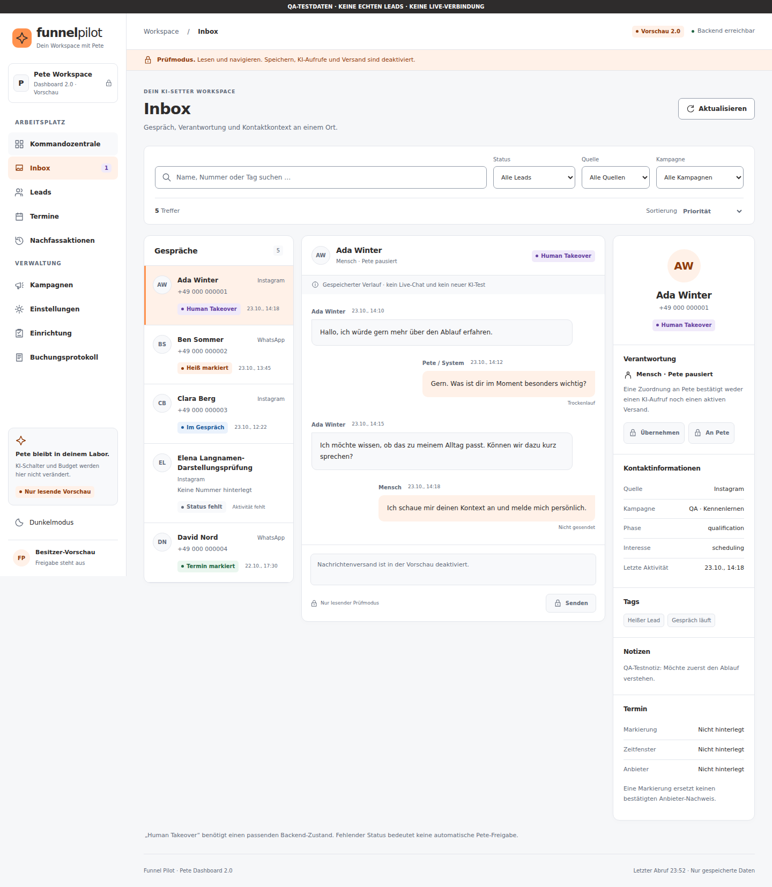

# Funnel Pilot Dashboard 2.0 · Ergebnis zur separaten Prüfung

Stand: 23.10.2026. **Deaktivierte, ausschließlich lesende Vorschau im bestehenden React-Projekt.**

Entwicklungszweig: `feat/dashboard-v2-preview-20261023`. Geschützter Ausgangspunkt: `d3c1bd5a0fa31eeec5117da0530136980a659f85` aus PR #191. Das bisherige Dashboard, Pete-Chat, Budgetsystem, Backend und Laptop-Starter wurden nicht geändert. Es wurde nichts gemergt oder ausgeliefert.

## Was umgesetzt wurde

| Bereich | Bisheriges Dashboard | Dashboard 2.0 Vorschau |
| --- | --- | --- |
| Design | Blaue Akzente, viele kleine Einzelflächen und Inline-Stile | Eigenes, gekapseltes Designsystem mit Orange `#ff914d`, Anthrazit `#2e2c2c`, Weiß, konsistenten Abständen und Statusfarben |
| Navigation | Arbeitsplatz und aufklappbare Verwaltung | Bestehende Bereiche als klare Navigation mit Symbolen; mobile Navigation mit Fokusführung und Escape |
| Übersicht | Kontakte, gespeicherte Lead-Markierungen, Sicherheitscheck | Kommandozentrale mit Human Takeover, Lead-Prioritäten, Begründung der Reihenfolge und direkten Ansichtswechseln |
| Leads | Suche und Formular im festen Zweispaltenraster | Kombinierte Suche, Status-, Quellen- und Kampagnenfilter, drei Sortierungen, sichtbare Trefferzahl und Filter-Rücksetzung |
| Inbox | Kontaktliste, Chat und technischer Kontext | Einheitliche Liste, gespeicherter Gesprächsverlauf, Verantwortlichkeit, Notizen, Tags und Terminkontext; mobile Einzelansichten |
| Status | Teilweise angenommene Standardwerte beim Normalisieren | Fehlende Quelle, Aktivität oder Gesprächszuordnung bleiben unbekannt; unbekannte Kennzahlen sind `—` |
| Kampagnen | Umfangreicher Editor mit vielen Abschnitten | Kompakte Auswahl und vier verständliche Schritte: Eingang, Antwort, Pete-Übergabe, Nachfassen/Termin; vorhandene Entwurfsprüfung |
| Nachfassen | Auswertung und ausführbare Aktionen | Kontaktbezogene vorhandene Backend-Auswertung mit Grund und Zeitpunkt; keine neue Zeitlogik oder Versandfunktion |
| Onboarding | Modaler Ablauf; bekannte Lesbarkeitsprobleme | Sechs klar gegliederte Ansichten mit expliziten Textfarben und lesbaren Überschriften in beiden Farbmodi |
| Änderungen | Bestehende Schreib- und Sendefunktionen | Speichern, Anlegen, Löschen, Verbinden, Takeover, Freigeben und Senden sind deaktiviert; Schreibdienste werden nicht importiert |

Die Vorschau verwendet dieselben Backend-Ressourcen, Navigationsschlüssel und vorhandene reine Funktionen für Priorität, Inbox-Signale, Onboarding und Kampagnenprüfung. Es gibt kein neues CRM, keine weitere Datenbank und keine kopierte Backend-Struktur.

### Datenherkunft und Grenzen der Anzeigen

- Listen stammen ausschließlich aus `/leads`, `/campaigns`, `/conversations`, `/booking-events` und `/ghosting/schedule`. Konfigurationsstatus kommt aus `/settings-config` und `/health/readiness`.
- Ein privates Gespräch wird nur bei eindeutiger Lead- und Kampagnen-ID zugeordnet. Namens- oder Telefonnummernähnlichkeit reicht nicht. Abweichende Detail-IDs werden verworfen.
- „Heiß“ und „im Gespräch“ sind gespeicherte Markierungen. Human Takeover zählt bestätigte menschliche Zuständigkeit oder Pause. Eine Pete-Zuordnung beweist keinen KI-Aufruf.
- Ein Termin im Lead ist eine Markierung. Anbieterzustellung, Kalender-Synchronisation, Umsatz, Conversion, ungelesene Nachrichten und Kaufwahrscheinlichkeiten werden nicht behauptet.
- Nachfass-Fälligkeit kommt aus dem vorhandenen Backend. Die Vorschau ändert weder die bestehenden Versandgrenzen noch das 24-Stunden-Fenster.
- Die gefüllten Screenshots verwenden **ausschließlich sichtbar gekennzeichnete synthetische Browser-Testdaten**. Sie wurden nicht im Backend gespeichert und zeigen keine echten Kunden oder bewiesene Geschäftsergebnisse. Der Besitzer-Datenbestand auf dem Pete-Laptop war hier nicht verfügbar.

## Screenshots im direkten Vergleich

Beide Vorher-/Nachher-Ansichten verwenden dieselben fünf ausdrücklich synthetischen QA-Kontakte. Die Vorher-Aufnahmen zeigen den unveränderten bestehenden Code. Dessen automatische Schreibversuche beim Laden wurden im Browser-Test abgefangen und mit HTTP 403 abgewiesen.

| Bisherige Übersicht | Dashboard 2.0 · Hell |
| --- | --- |
|  |  |

| Bisherige Inbox | Dashboard 2.0 Inbox |
| --- | --- |
|  |  |

Weitere geprüfte Ansichten:

- [Kommandozentrale dunkel](screenshots/dashboard-1440-dark.png)
- [Kommandozentrale mobil, 360 Pixel](screenshots/dashboard-360-light.png)
- [Inbox mobil, 360 Pixel](screenshots/inbox-360-light.png)
- [Kampagnen](screenshots/campaigns-1440-light.png)
- [Onboarding hell](screenshots/onboarding-1440-light.png) und [dunkel](screenshots/onboarding-1440-dark.png)
- [Bestätigter Leerzustand im QA-Test](screenshots/dashboard-empty.png)
- [Offline-Zustand ohne verfügbare Daten](screenshots/dashboard-offline.png)
- [Tatsächlicher Standardzustand: Vorschau deaktiviert](screenshots/preview-disabled.png)

## Tatsächlich bestandene lokale Prüfungen

Die maschinenlesbaren Ergebnisse und SHA-256-Prüfsummen der 13 Screenshots stehen in [verification.json](verification.json). Ausgeführt mit Node 24.19.0 und Chromium über Playwright 1.56.1; die ergänzende GitHub-CI verwendet Node 22.

| Prüfung | Ergebnis |
| --- | --- |
| Bestehendes Frontend `npm run build`, einschließlich bisheriger Tests | **102/102**, Standard-Dashboard und Pete-Labor gebaut |
| Vorschau-Daten- und Sicherheitslogik `npm run test:dashboard-v2` | **18/18** |
| Chromium `npm run test:dashboard-v2:browser` | **20/20**, keine übersprungenen oder instabilen Tests |
| Automatisierte axe-Prüfungen WCAG 2 A/AA und 2.1 AA | **28 Ansichts-/Schrittzustände**, 0 gemeldete Verstöße, Hell und Dunkel |
| Responsive Bedienung und horizontaler Überlauf | **360, 768, 1440 Pixel**, jeweils Hell/Dunkel bestanden |
| Backend-Regression `npm run check` | **520/520**, TypeScript-Build bestanden |
| Unverändertes Desktop-Labor | **17/17** |
| Relay-/Starter-Regressionsprüfungen | **25/25** |
| Vorschau-Build ohne Freigabe | Bestanden; Datenclient aus dem deaktivierten Bundle entfernt |
| Vorschau-Build mit ausdrücklich gesetztem Entwicklungsflag | Bestanden; ausschließlich separates Vorschau-Ausgabeverzeichnis |
| Standard-Build-Isolation | Kein Vorschau-Einstieg in `dist/index.html` oder im Standard-Ausgabeverzeichnis |

Die Browserprüfungen enthalten unter anderem: Standard-Aus ohne Backend-Aufruf, kein Einschalten per URL-Parameter, verweigerte POST/PUT/PATCH/DELETE-Anfragen, nur freigegebene GET-Ressourcen, gesperrte Aktionen, kombinierte Filter, Lade-/Leer-/Fehlerzustände und Wiederherstellung, Escape/Fokus im mobilen Menü, reine Textausgabe bei HTML-Injektion und Schutz vor falsch zugeordneten Gesprächsdetails. Die Vorschau schreibt weder Local Storage noch Session Storage.

Automatisierte Barrierefreiheitsprüfungen ersetzen keine vollständige manuelle Screenreader-Abnahme. Die bekannten Ansichten und Screenshots wurden zusätzlich visuell kontrolliert.

### Sicherheitsbefunde bleiben offen

`npm audit` ist **nicht grün**. Es meldet weiterhin die bereits vorhandenen Abhängigkeiten:

| Paketbereich | Kritisch | Hoch | Mittel | Niedrig | Gesamt |
| --- | ---: | ---: | ---: | ---: | ---: |
| Backend | 1 | 1 | 1 | 2 | 5 |
| Dashboard, vor und nach diesem Paket identisch | 0 | 5 | 2 | 1 | 8 |

Die vorhandenen Dependency-Versionen wurden nicht verändert. Neu sind ausschließlich die Entwicklungswerkzeuge Playwright und axe samt ihren Testabhängigkeiten. Für sie weist der durchgeführte Audit keinen zusätzlichen Befund aus. Ein Dependency-Upgrade mit eigenen Kompatibilitätstests bleibt ein separates Paket vor einer späteren Auslieferung.

## Prüfbarkeit und deaktivierter Standard

`dashboard/preview-v2.html` und `vite.dashboard-v2.config.js` sind ein zusätzlicher Einstieg **innerhalb desselben Vite-Projekts**. Das bestehende `index.html`, `main.jsx`, `App.dashboard.jsx`, Pete-Labor und sämtliche Starter bleiben erhalten.

Ohne `FUNNELPILOT_DASHBOARD_V2_PREVIEW=1` zeigt der Einstieg nur „Dashboard 2.0 ist deaktiviert“ und lädt keine Backend-Daten. Auch URL-Parameter schalten ihn nicht ein. Der normale Build enthält die Vorschau nicht. Es gibt keinen automatischen Aktivierungs- oder Updatepfad.

Die spätere technische Prüfung erfolgt nach Abschluss des Besitzer-Laptop-Tests auf diesem Dashboard-Zweig. Für Entwickler, im Verzeichnis `dashboard`:

```sh
npm ci
npm run test:dashboard-v2
npm run build
npm run build:dashboard-v2
node qa/dashboard-v2/check-build.mjs
npx --no-install playwright install chromium
npm run test:dashboard-v2:browser
```

Für die ausdrücklich gewünschte, lokale Ansichtsprüfung kann ein Entwickler das Vorschau-Flag nur in seinem Review-Terminal setzen und `npm run dev:dashboard-v2` starten. Unter PowerShell: `$env:FUNNELPILOT_DASHBOARD_V2_PREVIEW="1"`; unter einer POSIX-Shell: `FUNNELPILOT_DASHBOARD_V2_PREVIEW=1 npm run dev:dashboard-v2`. Das ist kein Installationsschritt für den aktuellen Pete-Laptop und keine Produktivfreigabe.

Der Vorschau-Server bindet an `127.0.0.1:5175`; ausschließlich geprüfte GET-Anfragen gehen an das bestehende lokale Backend auf `127.0.0.1:3001`. Der Client akzeptiert keine externe API-Basis, API-Schlüssel oder Request-Bodies. Nicht verfügbare Daten werden als fehlend ausgewiesen. Produktionsbetrieb und Schutz eines öffentlich erreichbaren Backends sind nicht Gegenstand dieses Vorschau-Servers.

## Verbleibende Abnahme und nächster Schritt

1. Der Besitzer schließt den bereits laufenden Pete-Laptop-Test ab. PR #191 und die aktuelle Testversion bleiben dabei unverändert.
2. Danach separate Sichtprüfung dieses Dashboard-Zweigs mit dem vorhandenen Laptop-Datenbestand, einschließlich echter Feldvarianten und größerer Kontaktmengen. Hier wurde kein erfolgreicher Datenzugriff auf den Besitzer-Laptop nachgewiesen.
3. Die bestehenden Audit-Befunde vor einer späteren Auslieferung beheben und erneut prüfen. Es besteht keine Auslieferungsfreigabe.
4. Erst nach einer eigenen Freigabe folgt ein gesondertes Paket zum sicheren Anbinden schreibender Aktionen. In diesem Paket bleiben Speichern, Takeover und Versand gesperrt.

Kostenpflichtige KI bleibt an den bestehenden Desktop-Schalter und den Nachweis historischer Ausgaben gebunden. Diese Vorschau hebt keine Kosten- oder Sicherheitsblockade auf. Tatsächlich ausgeführte kostenpflichtige Modellaufrufe: **0**. Live-Sends, Merges und Deployments: **0**.
